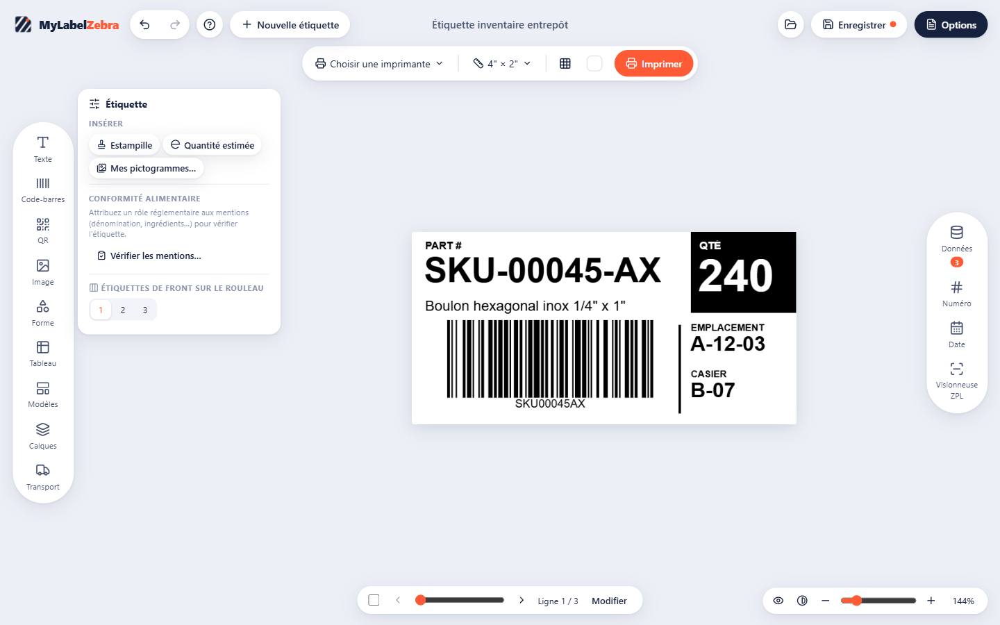
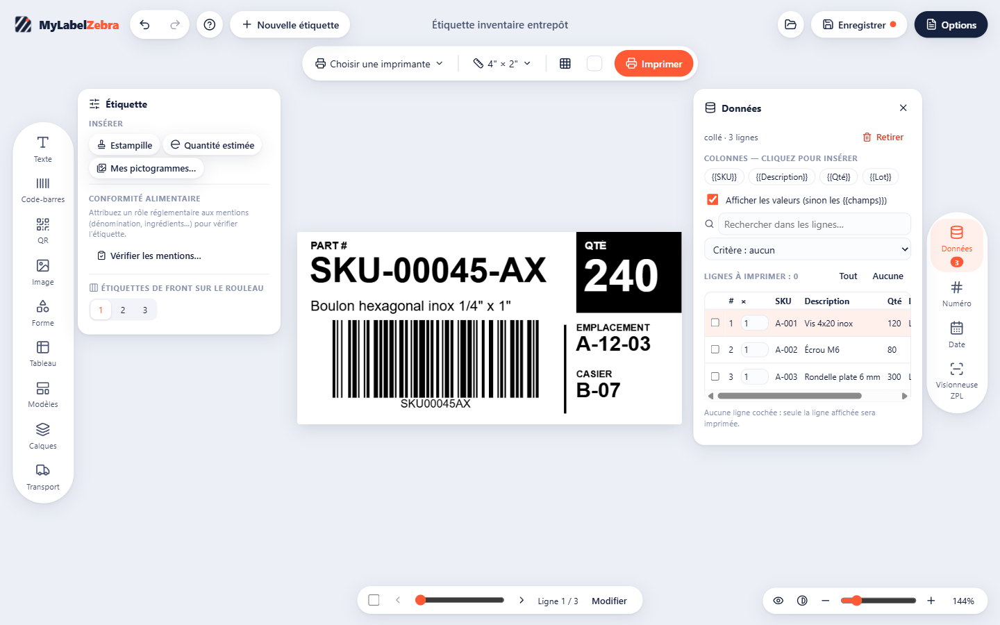

# MyLabelZebra

étiquettes’étiquettes gratuit qui fonctionne entièrement dans le navigateur**, pour les imprimantes thermiques Zebra (ZPL) comme pour les imprimantes de bureau (PDF, planches Avery). Aucune donnée n’est envoyée à un serveur : vos étiquettes, vos fichiers de données et votre historique restent dans votre navigateur.



> **English summary** — MyLabelZebra is a source-available label designer (not open source: see the [license](LICENSE) — free for study, personal use and internal use; commercial use subject to a 5 % revenue share; SaaS/hosting for third parties prohibited without written agreement) that runs 100 % in the browser (Vite + React + TypeScript, installable PWA). Design labels with text, barcodes (Code 128, GS1-128, EAN/UPC, SSCC, DataMatrix, QR, GS1 Digital Link, PDF417, Aztec, DataBar…), images, shapes and tables; merge CSV / Excel / Google Sheets data with `{{column}}` fields and filters; print to Zebra printers through **Zebra Browser Print** or export **ZPL**, PDF, PNG, SVG and Avery sheets. It also includes a ZPL viewer/linter, carrier-label printing (ZPL/PDF/images → ZPL), GS1 helpers (SSCC counter, AI builder, variable-weight EAN-13) and EU food-labelling aids. Nothing is uploaded: data stays in IndexedDB/localStorage. The UI is in French with an English translation (`?lang=en`). Quick start (personal / internal use): `npm ci && npm run dev`, or `docker compose up -d` → <http://localhost:8080>. Full documentation (in French) is in [`docs/`](docs/README.md).

## Sommaire

- [Fonctionnalités](#fonctionnalités)
- [Démarrage rapide](#démarrage-rapide)
- [Installation avec Docker](#installation-avec-docker)
- [Utilisation en 5 minutes](#utilisation-en-5-minutes)
- [Confidentialité](#confidentialité)
- [Limites connues](#limites-connues)
- [Documentation](#documentation)
- [Contribuer](#contribuer) · [Licence](#licence)

## Fonctionnalités

- **Éditeur visuel** : texte (ajustement automatique à la boîte, texte courbé, inversé), codes-barres, QR codes (URL, Wi-Fi, vCard), images (seuil et tramage pour l’impression thermique), 22 formes, symboles d’entretien textile, pictogrammes de danger, tableaux. Calques, groupes, alignement et répartition, repères intelligents, règles en mm ou en pouces, annuler/rétablir sur 80 étapes.
- **20 symbologies** (moteur bwip-js) : CODE 128, GS1-128, EAN-13, EAN-8, UPC-A, UPC-E, CODE 39, CODE 93, ITF, SSCC-18, Codabar, Data Matrix, GS1 DataMatrix, PDF417, Aztec, GS1 QR Code, QR GS1 Digital Link, GS1 DataBar (omnidirectionnel, empilé, Expanded) — validation immédiate des clés de contrôle.
- **Fusion de données** : CSV/TSV, Excel (`.xlsx`, `.xls`, `.xlsm`), OpenDocument (`.ods`), copier-coller depuis un tableur, lien Google Sheets. Champs `{{colonne}}` avec **filtres** (`{{prix|prix}}`, `{{date|jours:+5|date:JJ/MM/AAAA}}`, `calc`, `prixkg`, `si`/`sinon`…), conditions d’affichage, valeurs saisies à l’impression `{{?Lot}}`, numérotation `{{numero}}`, `{{#pos}}/{{#total}}`, `{{#sscc}}`.
- **GS1 et logistique** : assistant GS1-128 / Digital Link par identifiants d’application, compteur SSCC sans doublon avec journal, EAN-13 à poids/prix variable, contrôle des dimensions des codes logistiques.
- **Étiquetage alimentaire** (aide, pas un conseil réglementaire) : allergènes en gras, DLC/DDM, tableau nutritionnel, rôles INCO et vérification des mentions, hauteur de x, estampille sanitaire, signe ℮, bibliothèque de pictogrammes.
- **Impression et export** : Zebra Browser Print (choix de l’imprimante, lecture des réglages, état), ZPL natif (texte, codes, formes) ou tout en image `^GFA`, PDF, PNG, JPG, SVG, planches A4/Letter (Avery) avec calibrage, rouleaux de 2 ou 3 étiquettes de front, aperçu thermique, historique d’impression avec réimpression à l’identique.
- **Outils** : visionneuse et vérificateur ZPL (conversion en étiquette modifiable), étiquettes transporteur (ZPL tel quel, PDF/images convertis en ZPL), générateurs de code-barres et de QR code.
- **Intégration** : impression pilotée par un lien (`?modele=…&data=…&imprimer=zebra`) ou par `window.postMessage`, avec confirmation à la première utilisation.
- **16 modèles** prêts à l’emploi, formats Zebra, Rollo, DYMO, Brother, logistique et ronds ; PWA utilisable hors ligne ; interface en français et en anglais ; adaptée au mobile.

## Démarrage rapide

Prérequis : **Node.js 22.13 ou plus récent** (Node 22 LTS ou 24) et npm. Vite 5 fonctionne dès Node 18, mais `pdfjs-dist` 6 (lecture des PDF transporteur) déclare `node >= 22.13`.

```bash
git clone <url-du-depot> mylabelzebra
cd mylabelzebra
npm ci              # installe les dépendances exactes de package-lock.json
npm run dev         # serveur de développement : http://localhost:5173
npm test            # tests unitaires (Vitest)
npm run build       # vérification TypeScript + build de production dans dist/
npm run preview     # sert dist/ (service worker et mode hors ligne actifs)
```

Sous Windows, lancez ces commandes dans PowerShell. Le dossier `dist/` est un site statique : il peut être servi par n’importe quel serveur web (voir [Installation](docs/installation.md)).

## Installation avec Docker

L’image construit l’application puis la sert avec nginx (utilisateur non root, port 8080, ~80 Mo). Elle est destinée à un **usage personnel ou interne** : mettre l’application à disposition de tiers (service hébergé, SaaS) est interdit sans accord écrit — voir la [licence](#licence).

```bash
docker compose up -d          # construit l’image et démarre le conteneur
# → http://localhost:8080
docker compose down           # arrête et supprime le conteneur
```

Port différent : `MLZ_PORT=9000 docker compose up -d` (ou `MLZ_PORT=9000` dans un fichier `.env`). Sans Compose :

```bash
docker build -t mylabelzebra .
docker run -d --name mylabelzebra -p 8080:8080 --restart unless-stopped mylabelzebra
```

Détails (cache, en-têtes, HTTPS, procédure de test) : [docs/installation.md](docs/installation.md#docker).

## Utilisation en 5 minutes

1. **Créer une étiquette** : choisissez la taille et la résolution dans la barre du haut (ex. 4″ × 2″, 203 dpi), ou partez d’un modèle (bouton **Modèles** à gauche). Ajoutez un **Texte**, un **Code-barres**, un **QR**, une image ou une forme depuis la barre de gauche ; modifiez-les dans le panneau de propriétés.
2. **Importer des données** : panneau **Données** (à droite) → *Importer un fichier CSV ou Excel*, collez directement des cellules copiées depuis un tableur, ou indiquez un lien Google Sheets publié en CSV. Une ligne = une étiquette ; cochez les lignes à imprimer.
3. **Insérer des champs** : cliquez sur le nom d’une colonne pour insérer `{{colonne}}` dans l’élément sélectionné. Ajoutez des filtres : `{{prix|prix}}` → `12,50 €`, `{{nom|maj}}`, `{{fabrication|jours:+21|date:JJ/MM/AAAA}}`. Le curseur sous l’étiquette fait défiler les lignes.
4. **Imprimer** :
   - **Imprimante Zebra** : installez [Zebra Browser Print](https://www.zebra.com/us/en/support-downloads/software/printer-software/browser-print.html), puis **Imprimer** → *Imprimante Zebra* ; l’étiquette est envoyée en ZPL.
   - **Sans Browser Print** : *Options* → *Télécharger le ZPL (.zpl)* (à envoyer par vos propres moyens), ou *Télécharger en PDF…*, ou **Imprimer** → *Cet ordinateur* (impression navigateur à 100 %).
5. **Enregistrer** : bouton **Enregistrer** (Ctrl+S) ; vos étiquettes sont dans *Mes étiquettes* (jusqu’à 50, stockées dans ce navigateur). *Options* → *Exporter l’étiquette* produit un fichier JSON pour la sauvegarder ou la partager.



## Confidentialité

MyLabelZebra est une application 100 % côté navigateur :

- aucun compte, aucune télémétrie, aucun envoi de vos étiquettes ou de vos données à un serveur ;
- les étiquettes enregistrées, l’historique d’impression, le compteur SSCC et les préférences sont stockés **localement** (IndexedDB et localStorage) dans le navigateur utilisé — ils ne sont ni synchronisés ni sauvegardés ailleurs : exportez vos étiquettes en JSON pour les conserver ;
- les seules requêtes réseau sortantes sont celles que vous déclenchez : le service local **Zebra Browser Print** sur votre poste (`127.0.0.1:9100` / `9101`) et le lien **Google Sheets** que vous saisissez ;
- le serveur qui héberge l’application (nginx, Netlify…) ne sert que des fichiers statiques.

## Limites connues

- Planches Avery : les dimensions suivent les gabarits publiés (marges et pas vérifiés pour retomber exactement sur la page), mais chaque imprimante de bureau décale un peu la page. Faites une impression test sur papier ordinaire à 100 %, puis corrigez avec « Calibrage de l’imprimante » (décalage X/Y en mm) dans la fenêtre des planches.
- La visionneuse ZPL gère les orientations N/R/I/B (`^A`, `^FW`, codes-barres) et les origines `^FO`/`^FT`, mais elle imite les polices Zebra : `^A0` est rendue par une linéale grasse condensée, les polices bitmap A–H par une police à chasse fixe aux mêmes dimensions de cellule. L’aperçu reste approximatif au pixel près.
- Le texte natif ZPL utilise la police `^A0` de l’imprimante, dont les métriques diffèrent d’Arial. Dès qu’une ligne frôle le bord de sa boîte, ou que la police n’est pas une sans-serif courante, le texte est envoyé en image pour rester fidèle à l’écran. L’option « ZPL : envoyer ce texte en image » force ce comportement pour un texte donné.
- ZPL et gris : une imprimante thermique n’imprime que des points noirs. Les gris (textes, formes, fond) sont donc tramés (trame ordonnée 8×8 alignée sur les points d’impression), avec une densité égale au gris choisi. Les codes-barres et QR restent toujours en noir pur pour rester lisibles.
- Changer la taille de l’étiquette met le contenu à l’échelle et le recentre (« Adapter à la taille »), ou le garde tel quel en le ramenant dans l’étiquette (« Garder la taille ») : réglage dans le menu de taille.
- Zebra Browser Print n’a pas pu être testé faute d’imprimante. La lecture des réglages et des états repose sur la documentation ZPL (`~HI`, `^HH`, `~HS`).
- Allergènes : le repérage se fait sur une liste de mots (français) ; il ne remplace pas la vérification réglementaire de la liste d’ingrédients. Un mot ambigu (« noix » seul, « crème » d’un dessert sans lait…) est mis en gras par prudence ; ajoutez les cas propres à vos recettes dans la liste complémentaire. Plus généralement, les aides à l’étiquetage alimentaire ne sont **pas un conseil réglementaire**.
- Formats : un `|` ne peut pas figurer dans l’argument d’un filtre (`remplacer`, `defaut`). `date:` lit les dates jour/mois/année (convention française) : une date américaine mm/jj/aaaa sera mal lue.
- GS1-128 : la reconstruction « (AI)valeur » dans la visionneuse ZPL repose sur une table des longueurs d’AI courantes ; un AI exotique est affiché comme Code 128 brut (barres identiques). Les caractères GS1 autorisés dans les AI alphanumériques sont limités aux lettres sans accent, chiffres et ponctuation simple (pas d’espace).
- Impression pilotée : la page doit être ouverte dans le navigateur où les modèles sont enregistrés (stockage local) ; l’impression navigateur (« ordinateur ») ouvre toujours la boîte de dialogue d’impression du navigateur.
- Volumes : 5 000 lignes de données importées au maximum, 500 étiquettes pour une série numérotée, 50 étiquettes dans « Mes étiquettes », 500 travaux (et 40 Mo) dans l’historique.
- Hébergement dans un sous-dossier (ex. GitHub Pages `https://user.github.io/mylabelzebra/`) : le service worker et le manifeste utilisent des chemins absolus (`/sw.js`, `/`) ; l’application fonctionne mais le mode hors ligne n’est pas garanti. Préférez une racine de domaine (voir [installation](docs/installation.md#github-pages)).
- `bwip-js` (moteur de codes-barres, ~240 Ko compressé) reste le plus gros fichier chargé au démarrage. jsPDF, JSZip, SheetJS et pdf.js ne sont chargés qu’au premier export, import Excel ou import PDF.
- `xlsx` est la version 0.20.3 distribuée par SheetJS (cdn.sheetjs.com), qui corrige les failles de la 0.18.5 de npm : `npm ci` doit pouvoir joindre `cdn.sheetjs.com`.

## Documentation

Le guide complet (en français) est dans [`docs/`](docs/README.md) :

| Thème | Fichier |
| --- | --- |
| Installation (local, Docker, hébergement statique) | [docs/installation.md](docs/installation.md) |
| Éditeur, raccourcis clavier | [docs/editeur.md](docs/editeur.md) |
| Données, champs et filtres | [docs/donnees-et-fusion.md](docs/donnees-et-fusion.md) |
| Codes-barres et GS1 | [docs/codes-barres-gs1.md](docs/codes-barres-gs1.md) |
| Étiquetage alimentaire | [docs/etiquetage-alimentaire.md](docs/etiquetage-alimentaire.md) |
| Impression et export | [docs/impression-et-export.md](docs/impression-et-export.md) |
| Étiquettes transporteur | [docs/etiquettes-transporteur.md](docs/etiquettes-transporteur.md) |
| Visionneuse et vérificateur ZPL | [docs/visionneuse-zpl.md](docs/visionneuse-zpl.md) |
| Intégration (lien, postMessage) | [docs/integration.md](docs/integration.md) |
| FAQ et dépannage | [docs/faq.md](docs/faq.md) |
| Développement | [docs/developpement.md](docs/developpement.md) |

## Contribuer

Les signalements de bugs et propositions sont les bienvenus : voir [CONTRIBUTING.md](CONTRIBUTING.md). Avant une pull request : `npx tsc --noEmit`, `npm test` et `npm run build` doivent passer (c’est ce que vérifie la CI GitHub Actions, avec la construction de l’image Docker).

## Licence

MyLabelZebra est publié sous la **Commercial Source License – Revenue Share v1.0** (© 2026 MASSON Thomas). C’est une licence **à source disponible, pas une licence open source** (non approuvée par l’OSI). En résumé :

- **gratuit** pour consulter, étudier et évaluer le code, pour un **usage personnel** et pour un **usage interne** au sein d’une organisation (y compris pour ses propres activités), tant que le logiciel n’est ni mis à disposition de tiers ni commercialisé séparément ;
- **modifications et forks non commerciaux** autorisés, sous la même licence et en conservant les mentions ;
- **usage commercial** (produit ou service payant qui intègre le logiciel) soumis à une **redevance de 5 % du revenu net attribuable**, avec relevés trimestriels ;
- **interdits sans accord écrit** du titulaire : offre en **SaaS / service hébergé pour des tiers** (même gratuit), revente ou distribution commerciale de copies, fork commercial ;
- droit français ; demandes commerciales : contact@thomasmasson.fr.

Ce résumé est indicatif : **seul le texte du fichier [LICENSE](LICENSE) fait foi.**

Bibliothèques principales : React, Konva / react-konva, bwip-js, jsPDF, JSZip, PapaParse, SheetJS (xlsx), pdf.js, zustand, lucide-react — chacune sous sa propre licence. « Zebra », « ZPL », « Avery », « DYMO », « Brother », « Rollo » et « GS1 » sont des marques de leurs propriétaires respectifs ; ce projet n’est affilié à aucun d’eux.
