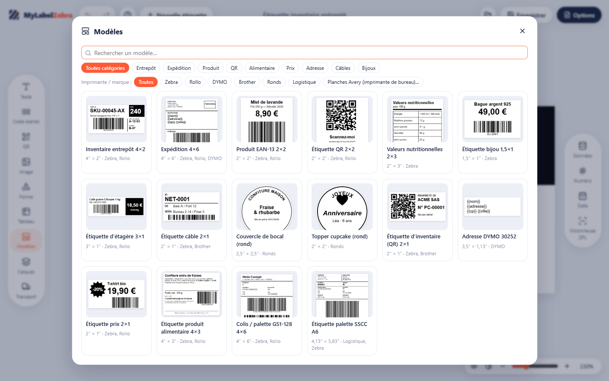

# Documentation de MyLabelZebra

Guide complet de l’éditeur d’étiquettes MyLabelZebra. Retour au [README du projet](../README.md). Licence : [LICENSE](../LICENSE) (source disponible, non open source ; usage personnel et interne gratuit, usage commercial soumis à redevance, SaaS interdit sans accord écrit).

## Sommaire

1. [Installation](installation.md) — développement local, build, Docker (procédure testée), hébergement statique gratuit (Netlify Drop, Cloudflare Pages, GitHub Pages).
2. [L’éditeur](editeur.md) — interface, éléments, propriétés, calques, alignement et répartition, grille et repères, raccourcis clavier, modèles et formats.
3. [Données et fusion](donnees-et-fusion.md) — import CSV / Excel / Google Sheets, filtres de lignes, champs `{{colonne}}`, **tous les filtres** avec exemples, dates, calculs, conditions d’affichage, saisies `{{?…}}`, numérotation, `{{#pos}}` / `{{#total}}`, `{{#sscc}}`.
4. [Codes-barres et GS1](codes-barres-gs1.md) — symbologies, assistant GS1-128 et Digital Link, EAN-13 à poids/prix variable, SSCC (compteur, journal), contrôles logistiques.
5. [Étiquetage alimentaire](etiquetage-alimentaire.md) — rôles INCO et vérification des mentions, allergènes, DLC/DDM, tableau nutritionnel, hauteur de x, estampille sanitaire, signe ℮, pictogrammes.
6. [Impression et export](impression-et-export.md) — Zebra Browser Print, résolution, ZPL, PDF, PNG/JPG/SVG, planches Avery et calibrage, rouleau multi-colonnes, aperçu thermique, historique.
7. [Étiquettes transporteur](etiquettes-transporteur.md) — imprimer les étiquettes ZPL / PDF / images fournies par les transporteurs.
8. [Visionneuse et vérificateur ZPL](visionneuse-zpl.md) — prévisualiser, vérifier, convertir et imprimer du ZPL.
9. [Intégration](integration.md) — piloter l’impression depuis un autre outil par lien ou `window.postMessage`, liens pré-remplis.
10. [FAQ et dépannage](faq.md) — Browser Print non détecté, HTTPS, stockage plein, accents CSV, impression décalée…
11. [Développement](developpement.md) — structure du code, tests, architecture de rendu écran / image / SVG / ZPL.

## Conventions de ce guide

- Les noms de boutons et de menus sont ceux de l’interface française, en **gras** ou entre « guillemets ».
- *Options* désigne le menu sombre en haut à droite ; la **barre de gauche** contient les outils d’ajout (Texte, Code-barres, QR, Image, Forme, Tableau, Modèles, Calques, Transport) ; la **barre de droite** contient Données, Numéro, Date et Visionneuse ZPL.
- Les dimensions internes sont exprimées en points à 203 dpi (1 point = 1/203 de pouce) ; la résolution réelle (203, 300 ou 600 dpi) n’intervient qu’à l’export.

