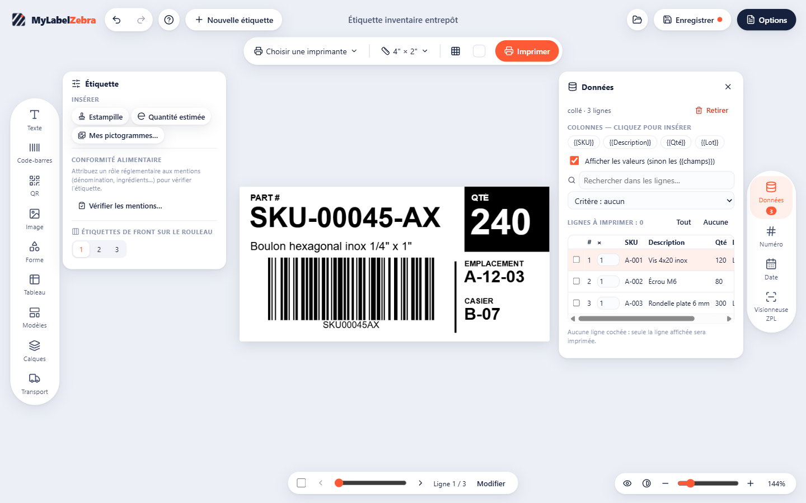

# Données et fusion

Une étiquette peut être imprimée en série à partir d’un tableau : **une ligne de données = une étiquette**. Les valeurs sont insérées avec des champs `{{colonne}}` dans les textes, codes-barres, QR codes, cellules de tableau, numéros d’agrément d’estampille et conditions d’affichage.

- [Importer des données](#importer-des-données)
- [Choisir les lignes à imprimer](#choisir-les-lignes-à-imprimer) (filtres, tri, *Aller à…*)
- [Vérifier le lot](#vérifier-le-lot)
- [Éclater une colonne](#éclater-une-colonne)
- [Générer des emplacements](#générer-des-emplacements)
- [Champs](#champs)
- [Filtres](#filtres)
- [Dates](#dates)
- [Conditions d’affichage](#conditions-daffichage)
- [Valeurs saisies à l’impression `{{?…}}`](#valeurs-saisies-à-limpression-)
- [Numérotation](#numérotation)
- [Position dans le travail : `{{#pos}}` / `{{#total}}`](#position-dans-le-travail--pos--total)
- [SSCC : `{{#sscc}}`](#sscc--sscc)

## Importer des données

Panneau **Données** (barre de droite) :

| Source | Détails |
| --- | --- |
| **Importer un fichier CSV ou Excel** | `.csv`, `.tsv`, `.txt`, `.xlsx`, `.xlsm`, `.xls`, `.ods`. Le séparateur CSV est détecté automatiquement (virgule, point-virgule, tabulation…), les guillemets sont gérés. On peut aussi déposer le fichier sur la page. |
| **Coller** | collez des cellules copiées depuis Excel, Google Sheets ou LibreOffice (ou un texte CSV/TSV) dans la zone prévue : le chargement est immédiat dès que le texte contient plusieurs lignes (sinon bouton *Charger le texte*). |
| **Lien Google Sheets publié (CSV)** | lien obtenu par *Fichier › Partager › Publier sur le Web › CSV* (`…/pub?output=csv`). Un lien de feuille `…/spreadsheets/d/<id>/edit#gid=…` est converti en lien d’export CSV de l’onglet indiqué ; il ne fonctionne que si la feuille est lisible sans connexion. Le lien publié est la méthode recommandée. |

Règles d’import :

- la **première ligne** contient les noms de colonnes ; un en-tête vide devient « Colonne N », un doublon « nom_2 » ;
- les lignes entièrement vides sont ignorées, les valeurs sont débarrassées des espaces de début et de fin ;
- **5 000 lignes** au maximum (un avertissement indique le nombre de lignes ignorées) ;
- **encodage** : un fichier texte est lu en UTF-8 ; s’il n’est pas en UTF-8 valide, il est relu en Windows-1252 (CSV « Excel » français classique) et un avertissement invite à vérifier les accents ;
- **classeurs** : choix de la feuille (*Feuille du classeur*) ; les dates Excel sont converties en texte JJ/MM/AAAA (avec l’heure si elle n’est pas minuit) ; un avertissement signale les nombres de plus de 15 chiffres (codes GTIN/SSCC saisis comme nombres) dont Excel a perdu les derniers chiffres — formatez la colonne en *Texte* dans Excel puis réimportez.

Les données sont enregistrées **avec l’étiquette** (dans le navigateur). *Retirer* les supprime.

## Choisir les lignes à imprimer

- Chaque ligne a une **case à cocher** (décochée à l’import) et un **nombre de copies** (×, de 1 à 999).
- *Tout* / *Aucune* ; **recherche** dans toutes les colonnes et **critère** sur une colonne (*contient*, *=*, *≠*, *est vide*, *n’est pas vide*, *doublon*, *EAN/GTIN invalide* — [détails](#critères-de-filtre)), puis *Cocher les lignes filtrées* / *Décocher*. Les comparaisons ignorent la casse et les accents.
- Cliquer sur une ligne l’affiche sur l’étiquette ; le curseur en bas de l’éditeur parcourt les lignes ; *Modifier la ligne* (crayon) corrige une valeur.
- *Afficher les valeurs (sinon les {{champs}})* bascule entre l’aperçu des données et l’affichage des champs bruts.
- Impression et export produisent **une étiquette par ligne cochée** (× copies). **Si aucune ligne n’est cochée, seule la ligne affichée est imprimée.**

### Critères de filtre

| Critère | Lignes gardées |
| --- | --- |
| *contient*, *=*, *≠* | la valeur de la colonne contient / est égale / est différente de la valeur saisie |
| *est vide*, *n’est pas vide* | cellule vide ou non |
| *doublon* | valeur non vide présente **sur plusieurs lignes** de la colonne : deux produits rangés dans le même `Emplacement`, un `Eaninterne` attribué deux fois… |
| *EAN/GTIN invalide* | valeur non vide qui n’est pas un GTIN de 8, 12, 13 ou 14 chiffres **avec une clé correcte** (`2000000000016` ou `/` dans `Eaninterne`) |

### Trier

Cliquez sur un **en-tête de colonne** du tableau pour trier les lignes (croissant ; un second clic : décroissant). Le tri est **naturel** : `ZB1-01-02` vient avant `ZB1-01-10`, `9` avant `10` ; il ignore la casse et les accents, et les cellules vides restent à la fin. Les cases cochées et les copies suivent leur ligne, et la ligne affichée reste la même. Le tri modifie l’ordre d’impression (donc `{{numero}}` et `{{#pos}}`) ; **Ctrl+Z** l’annule.

### Aller à une ligne

Le champ **Aller à…** accepte un **numéro de ligne** (`120`) ou un **texte à chercher** dans toutes les colonnes (`ZB1-04-03`, `ART1000002`, `CMR`). La ligne trouvée s’affiche sur l’étiquette et dans le tableau ; **Entrée** passe à l’occurrence suivante (« occurrence 2 sur 72 »), Échap efface. Un nombre plus grand que le nombre de lignes est cherché comme texte.

## Vérifier le lot

Le bouton **Vérifier le lot** (panneau Données) contrôle **les lignes cochées** (toutes les lignes si aucune n’est cochée) avec la même résolution des champs et la même mise en page que l’impression :

| Anomalie | Exemple (étiquette emplacement) |
| --- | --- |
| **Colonne introuvable** — `{{colonne}}` utilisée par le modèle (textes, codes, conditions) mais absente des données : une seule alerte, sans numéro de ligne | `{{Fournisseurr}}` ou `{{Emplacment}}` |
| **Code-barres invalide** pour sa symbologie (longueur, caractères, clé, AI GS1) | EAN-13 `2000000000016` (clé fausse) |
| **Champ vide** — texte alimenté par une colonne dont la valeur est vide, ou code-barres vide ou valant `/` | emplacement `/` |
| **Code-barres en double** — même valeur sur deux lignes contrôlées (signalée sur la seconde, avec le numéro de la première) ; ignoré pour un code fixe ou ne dépendant que de `{{numero}}` / `{{?saisie}}` | deux lignes `ZB1-01-01-A1` |
| **Texte réduit ou tronqué** — texte réduit jusqu’à sa taille minimale (*Une ligne, réduire* / *Retour à la ligne, réduire*) ou coupé (lignes en trop, « … ») | désignation produit trop longue |

- Un badge indique le nombre d’anomalies ; la liste est **groupée par type** (100 entrées affichées par groupe). Un clic sur une entrée affiche la ligne et **sélectionne l’élément** concerné.
- **Anomalie suivante** parcourt toutes les anomalies dans l’ordre des lignes.
- **Décocher les lignes en anomalie** retire ces lignes de l’impression (Ctrl+Z pour annuler).
- La vérification s’exécute par tranches avec une barre de progression (annulable) : 5 000 lignes restent fluides. Si l’étiquette ou les données changent ensuite, un message invite à la relancer.

## Éclater une colonne

**Éclater la colonne…** (panneau Données, *Outils*) crée **une ligne par valeur** ; les autres colonnes, la case cochée et les copies sont recopiées. Un aperçu indique le résultat (« 360 lignes → 377 ») et un exemple avant validation ; **Ctrl+Z** annule.

- **Séparateur** `/`, `;`, `,` ou `|` : `ART1000001 (CMR) / ART1000002` → `ART1000001 (CMR)` et `ART1000002` (espaces retirés, morceaux vides ignorés).
- **Cases multiples** : le préfixe jusqu’au dernier `-` est conservé et le dernier segment est découpé en motifs lettre + chiffres : `ZB1-04-03-B1B5C1C3` → `ZB1-04-03-B1`, `ZB1-04-03-B5`, `ZB1-04-03-C1`, `ZB1-04-03-C3`. Une valeur qui ne suit pas ce motif (`ZB1-01-01-A1`, `/`) reste inchangée.

Le résultat est limité à 5 000 lignes.

## Générer des emplacements

**Générer des emplacements…** (panneau Données, avec ou sans données) crée la liste de toutes les combinaisons de **segments** :

| Segment | Type | Valeurs |
| --- | --- | --- |
| Zone | texte fixe | `ZB1` |
| Allée | nombres 1 → 4, 2 chiffres | `01` … `04` |
| Travée | nombres 1 → 10, 2 chiffres | `01` … `10` |
| Niveau | lettres A → E | `A` … `E` |
| Position | nombres 1 → 5 | `1` … `5` |

Avec le modèle `{Zone}-{Allée}-{Travée}-{Niveau}{Position}`, on obtient 4 × 10 × 5 × 5 = **1 000 lignes** : `ZB1-01-01-A1`, `ZB1-01-01-A2`… `ZB1-04-10-E5` (le dernier segment varie le plus vite). Chaque segment devient une colonne, plus la colonne du résultat (`Emplacement` par défaut). Les plages peuvent être décroissantes (`5 → 1`, `E → A`) ; un modèle vide accole les segments.

Les lignes générées **remplacent** les données ou s’**ajoutent** aux lignes existantes (colonnes réunies), dans la limite de 5 000 lignes ; Ctrl+Z annule.

## Champs

Cliquez sur un nom de colonne (`{{colonne}}`) pour l’insérer dans l’élément sélectionné, ou utilisez le bouton **{} Champ** du panneau de propriétés (colonnes et champs spéciaux). Le nom de colonne est d’abord cherché tel quel, puis sans tenir compte de la casse ni des espaces autour.

| Champ | Valeur |
| --- | --- |
| `{{colonne}}` | valeur de la colonne pour la ligne (vide si la colonne n’existe pas ; sans données importées, le champ reste affiché tel quel) |
| `{{numero}}` (ou `{{numéro}}`, `{{#}}`, `{{serial}}`) | numéro de série ([Numérotation](#numérotation)) |
| `{{date}}` | date du jour au format et avec le décalage du panneau **Date** |
| `{{date+30}}`, `{{date-2}}` | date du jour ± N jours (ignore le décalage du panneau) |
| `{{aujourdhui}}` (ou `{{aujourd’hui}}`, `{{today}}`, `{{maintenant}}`) | date et heure courantes, à formater avec `|date:…` |
| `{{?Nom}}` | valeur demandée au moment d’imprimer ([détails](#valeurs-saisies-à-limpression-)) |
| `{{#pos}}` (ou `{{#colis}}`), `{{#total}}` (ou `{{#nb}}`) | position de l’étiquette dans le travail et nombre d’étiquettes ([détails](#position-dans-le-travail--pos--total)) |
| `{{#sscc}}` | SSCC 18 chiffres réservé pour l’étiquette ([détails](#sscc--sscc)) |

Lors d’une impression, `{{date}}` et `{{aujourdhui}}` valent la date du travail ; une réimpression depuis l’historique réutilise la même date.

## Filtres

Les filtres se placent après le nom du champ, séparés par `|`, et s’appliquent **de gauche à droite** : `{{champ|filtre1|filtre2:argument}}`. Ils fonctionnent partout où un champ est accepté, y compris dans les conditions d’affichage. Le bouton ⓘ à côté de **{} Champ** affiche la liste dans l’application. Un filtre inconnu laisse la valeur inchangée et un avertissement s’affiche dans le panneau de propriétés.

| Filtre | Effet | Exemple → résultat |
| --- | --- | --- |
| `defaut:TEXTE` | valeur de remplacement si le champ est vide | `{{lot|defaut:SANS LOT}}` → `SANS LOT` si vide |
| `si:TEXTE` | affiche TEXTE si le champ n’est pas vide, sinon rien | `{{lot|si:Lot présent}}` |
| `sinon:TEXTE` | affiche TEXTE si le champ (ou le résultat précédent) est vide | `{{lot|si:Avec lot|sinon:Sans lot}}` |
| `maj` | MAJUSCULES | `{{nom|maj}}` : `Dupont` → `DUPONT` |
| `min` | minuscules | `{{nom|min}}` |
| `cap` | première lettre en majuscule | `{{ville|cap}}` : `lyon` → `Lyon` |
| `trim` | retire les espaces au début et à la fin | `{{ref|trim}}` |
| `tronquer:N` | garde les N premiers caractères | `{{desc|tronquer:20}}` |
| `sous:N,L` | sous-chaîne à partir du caractère N (1 = premier, négatif = depuis la fin), sur L caractères (facultatif) | `{{ref|sous:3,4}}` : `AB1234XY` → `1234` ; `{{ref|sous:-2}}` → `XY` |
| `pad:N` | complète avec des zéros devant jusqu’à N caractères | `{{code|pad:6}}` : `42` → `000042` |
| `nombre:N` | nombre au format français, N décimales (2 par défaut) | `{{poids|nombre:3}}` : `1234.5` → `1 234,500` |
| `arrondi:N` | arrondit à N décimales (0 par défaut ; négatif = dizaines, centaines…), sans séparateur de milliers | `{{poids|arrondi:1}}` : `2,46` → `2,5` |
| `calc:EXPR` | calcul : `+ - * / ( )`, `x` (ou `valeur`) = la valeur ; une expression qui commence par un opérateur s’applique à la valeur ; `×` et `÷` acceptés | `{{prix|calc:*1,2}}` (TTC) ; `{{poids|calc:/1000}}` ; `{{t|calc:(x-10)/2}}` |
| `prix` | prix en euros, 2 décimales | `{{prix|prix}}` : `12.5` → `12,50 €` |
| `prixkg:COLONNE` | prix au kilo : valeur ÷ poids (kg) lu dans la colonne indiquée ; `prixkg:COLONNE,g` si le poids est en grammes. Rien si le poids est vide ou nul | `{{prix|prixkg:Poids|prix}}` : prix 4,90 et poids 0,350 → `14,00 €` ; `{{prix|prixkg:Poids g,g|prix}}` |
| `date:FORMAT` | lit une date (Excel, ISO, jj/mm/aaaa…) et la formate ; sans format, celui du panneau Date | `{{fabrication|date:JJ/MM/AAAA}}` |
| `jours:±N` | ajoute (ou retire) N jours à une date — **à placer avant `date`** | `{{fabrication|jours:+5|date:JJ/MM/AAAA}}` |
| `remplacer:A:B` | remplace le texte A par B (B vide = suppression) | `{{ref|remplacer:-:/}}` : `A-12` → `A/12` |
| `chiffres` | ne garde que les chiffres | `{{tel|chiffres}}` ; `{{poids|nombre:3|chiffres}}` : `1,25` → `1250` |
| `cleprix` | EAN-13 à prix variable : ajoute la clé « prix » devant 4 chiffres | `{{prix|nombre:2|chiffres|pad:4|cleprix}}` |
| `partie:N,SEP` | N-ième morceau après découpage par SEP (1 = premier, négatif = depuis la fin), espaces retirés ; morceau inexistant → vide. SEP = tout ce qui suit la première virgule (`partie:2,,` découpe aux virgules) ; entre guillemets s’il contient des espaces (`partie:2," - "`) ; omis = suite d’espaces | `{{Emplacement|partie:4,-}}` : `ZB1-01-01-A1` → `A1` ; `{{Ref|partie:1,/}}` : `ART1000001 (CMR) / ART1000002` → `ART1000001 (CMR)` ; `{{Ref|partie:-1,/}}` → `ART1000002` |
| `extraire:REGEX` | première correspondance de l’expression régulière (le groupe 1 s’il existe), vide si rien ne correspond ; expression invalide → valeur inchangée | `{{Ref|extraire:^[^ (]+}}` → `ART1000001` ; `{{Ref|extraire:\((\w+)\)}}` → `CMR` |
| `clegtin` | ajoute la clé de contrôle GS1 (modulo 10) à 7, 11, 12, 13 ou 17 chiffres (EAN-8, UPC-A, EAN-13, GTIN-14, SSCC) ; autre valeur inchangée | `{{Eaninterne|clegtin}}` : `200000000001` → `2000000000015` |
| `controle:N` | N chiffres de contrôle **stables** calculés à partir de la valeur (1 à 4, 2 par défaut) — « check digits » d’emplacement à imprimer en gros pour la préparation / le picking vocal ; vide si la valeur est vide | `{{Emplacement|controle}}` : `ZB1-01-01-A1` → `37` ; `{{Emplacement|controle:3}}` → `837` |

Alias acceptés : `défaut` / `default` → `defaut`, `upper` / `majuscules` → `maj`, `lower` / `minuscules` → `min`, `replace` → `remplacer`, `days` → `jours`, `round` → `arrondi`, `substr` → `sous`. Les noms de filtres ne tiennent pas compte de la casse.

Lecture des nombres (`nombre`, `arrondi`, `calc`, `prix`, `prixkg`) : `1 234,5`, `1234.5`, `1.234,50`, `12,50 €` sont reconnus ; une valeur non numérique est laissée telle quelle. Les résultats de `calc` et `arrondi` utilisent la virgule décimale, sans séparateur de milliers (ils peuvent être enchaînés avec `nombre` ou `prix`).

**Limite** : un `|` ne peut pas figurer dans l’argument d’un filtre (`remplacer`, `defaut`, `regex`, `extraire`…), ni une accolade fermante `}` : pour `extraire`, écrivez `\d\d\d\d` plutôt que `\d{4}`, et pas d’alternative `a|b`.

**Calcul de `controle`** (reproductible dans un tableur ou un WMS) : hash **FNV-1a 32 bits** des octets UTF-8 de la valeur sans espaces autour — `h = 2166136261`, puis pour chaque octet `b` : `h = (h XOR b) × 16777619 mod 2³²` — puis `h mod 10^N`, complété par des zéros devant. Les chiffres ne changent jamais pour un même emplacement ; deux emplacements différents peuvent avoir les mêmes chiffres (1 chance sur 100 avec N = 2) : ils servent à confirmer qu’on est devant la bonne case, pas à identifier l’emplacement. Exemples : `ZB1-01-01-A1` → `37`, `ZB1-01-01-A2` → `80`, `ZB1-04-03-B1` → `63`.

## Dates

**Dates lues** (filtres `date` et `jours`) : ISO `2026-11-19` (avec heure éventuelle), `19/11/2026` (séparateurs `/`, `.` ou `-`), `19/11/26` (années < 70 → 20xx), `20261119`, numéro de série Excel (`46345`), avec une heure éventuelle `14:30` ou `14h30`. Convention jour/mois/année : une date américaine mm/jj/aaaa sera mal lue.

**Jetons de format** (majuscules ou minuscules) :

| Jeton | Sens | Exemple |
| --- | --- | --- |
| `JJ` / `DD` | jour sur 2 chiffres | `09` |
| `MM` | mois sur 2 chiffres | `11` |
| `MMM` | mois abrégé | `nov.` |
| `MMMM` | mois en toutes lettres | `novembre` |
| `AA` / `YY` | année sur 2 chiffres | `26` |
| `AAAA` / `YYYY` | année sur 4 chiffres | `2026` |
| `HH` / `hh` | heure 0–23 | `14` |
| `mm` | **minutes** juste après `HH` (`HH:mm`, `HHhmm`) ou juste avant `ss` ; sinon **mois** (`jj/mm/aaaa` fonctionne) | |
| `ss` | secondes | |

Exemples : `{{aujourdhui|date:JJ MMMM AAAA}}` → `19 novembre 2026` ; `{{aujourdhui|date:AAMMJJ}}` (dates GS1) → `261119` ; `{{date|date:HH:mm}}`.

Le panneau **Date** (barre de droite) règle le format de `{{date}}` (liste ou *Personnalisé…*) et le décalage (*Aujourd’hui* ou *Aujourd’hui + N jours*), et propose l’assistant **Date limite (DLC / DDM)** décrit dans [Étiquetage alimentaire](etiquetage-alimentaire.md#dlc--ddm).

## Conditions d’affichage

Dans les propriétés de **n’importe quel élément** : *Afficher seulement si…* **[colonne ou champ] [est vide | n’est pas vide | = | ≠ | contient] [valeur]**.

- Le champ testé peut être une colonne (`lot`), un champ spécial (`numero`, `?Lot`, `#sscc`), avec ou sans accolades, et avec des filtres (`{{poids|arrondi:0}}`).
- La valeur de comparaison peut contenir des `{{champs}}`.
- Comparaison **insensible à la casse et aux accents** ; « contient » avec une valeur vide est toujours vrai.
- La condition est évaluée pour chaque ligne partout (éditeur, aperçu, impression, PDF, PNG, SVG, ZPL, planches). Dans l’éditeur, un élément dont la condition n’est pas remplie est estompé (masqué en aperçu) ; un badge « si » le signale dans les calques. Le panneau indique le résultat pour la ligne affichée (« imprimé » / « non imprimé »).

Exemple : un bandeau « PROMO » affiché seulement si la colonne `promo` = `oui`.

## Valeurs saisies à l’impression `{{?…}}`

`{{?Lot}}` ou `{{?Poids (kg)|nombre:3}}` déclare une valeur **demandée au moment d’imprimer ou d’exporter** (impression, PDF, PNG, JPG, SVG, ZPL, planches). Une fenêtre *Valeurs à saisir pour cette impression* liste les champs ; les valeurs valent pour **tout le travail** et les dernières sont mémorisées par étiquette (localStorage). Dans l’éditeur, la dernière valeur saisie (ou le nom du champ) est affichée. Mode douchette : **Entrée** passe au champ suivant et valide sur le dernier.

**Options de saisie** (placées comme des filtres, elles ne modifient pas la valeur) :

| Option | Effet | Exemple |
| --- | --- | --- |
| `liste:A;B;C` (ou `choix:`) | liste déroulante | `{{?Atelier|liste:Lyon;Paris;Lille}}` |
| `obligatoire` (ou `requis`) | refuse une valeur vide (champ marqué `*`) | `{{?Lot|obligatoire}}` |
| `gtin` | GTIN-8/12/13/14 avec clé de contrôle vérifiée | `{{?GTIN|gtin|obligatoire}}` |
| `regex:MOTIF` | la valeur entière doit correspondre à l’expression régulière (sans `|`) | `{{?Lot|regex:L[0-9]{4}}}` |
| `min:N`, `max:N` | nombre borné (saisie numérique) | `{{?Poids|min:0,1|max:30|nombre:3}}` |

`min` et `max` ne sont des options qu’avec un argument numérique : `{{?Nom|min}}` (sans argument) applique le filtre minuscules. Les options de toutes les occurrences d’un même champ sont fusionnées. L’impression est bloquée tant qu’une valeur est refusée. Pour une impression pilotée ([intégration](integration.md)), les valeurs fournies sont vérifiées de la même façon ; les champs non fournis reprennent les dernières valeurs ou sont demandés dans la fenêtre.

## Numérotation

Panneau **Numéro** (barre de droite), champ `{{numero}}` :

| Réglage | Effet |
| --- | --- |
| *Départ* | premier numéro (en base 36 si *Alphanumérique*) |
| *Pas (négatif = décompte)* | incrément |
| *Chiffres (zéros)* | longueur minimale, complétée par des zéros devant |
| *Quantité (max 500)* | nombre d’étiquettes de la série (sans données importées) |
| *Répéter chaque numéro* | même numéro sur N étiquettes de suite |
| *Alphanumérique (base 36)* | 0-9 puis A-Z : 9, A, B … Z, 10, 11… |
| *Préfixe*, *Suffixe* | texte avant / après |

L’aperçu affiche les premiers et le dernier numéro. Avec des données importées, il y a une étiquette par ligne cochée et le numéro suit l’ordre des lignes du fichier. **Après une impression Zebra du lot, le départ avance automatiquement** pour la série suivante.

Le bouton *Ajouter « colis 1/N »* insère `{{#pos}}/{{#total}}`.

## Position dans le travail : `{{#pos}}` / `{{#total}}`

- `{{#pos}}` : position (à partir de 1) de l’étiquette dans le travail ; `{{#total}}` : nombre d’étiquettes **différentes** du travail. Idéal pour « colis 2/5 ».
- Avec des données : rang parmi les lignes cochées et nombre de lignes cochées.
- Sans données : rang dans la série numérotée et *Quantité* de la série.
- Les copies (×N) d’une même étiquette sont identiques et ne sont pas comptées.

## SSCC : `{{#sscc}}`

`{{#sscc}}` insère un **SSCC (AI 00) de 18 chiffres unique**, issu d’un compteur propre à cet appareil/navigateur. À placer dans un code-barres **SSCC-18** (le « (00) » est ajouté) ou dans un texte. Un SSCC par ligne cochée ou par numéro de la série ; les copies gardent le même SSCC. La configuration (préfixe entreprise GS1, extension, prochain numéro) et le journal des SSCC émis sont décrits dans [Codes-barres et GS1](codes-barres-gs1.md#compteur-sscc-sscc).
