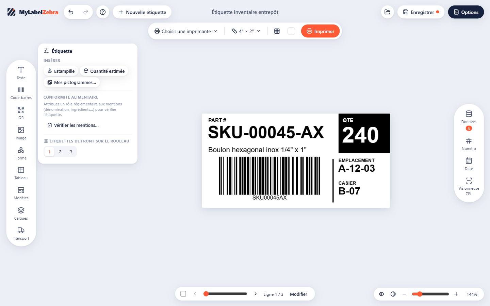

# L’éditeur

## Interface

| Zone | Contenu |
| --- | --- |
| Barre du haut | annuler / rétablir, **Aide** (?), **Nouvelle étiquette**, nom du document, *Mes étiquettes* (dossier), **Enregistrer** (point orange = modifications non enregistrées), menu **Options** |
| Barre de configuration (au centre) | *Choisir une imprimante* (Cet ordinateur / Imprimante Zebra, réglages Browser Print), **taille de l’étiquette**, grille et fond, bouton **Imprimer** |
| Barre de gauche | **Texte**, **Code-barres**, **QR**, **Image**, **Forme**, **Tableau**, **Modèles**, **Calques**, **Transport** |
| Barre de droite | **Données**, **Numéro**, **Date**, **Visionneuse ZPL** |
| Panneau de propriétés | propriétés de la sélection ; sans sélection, panneau **Étiquette** (estampille, signe ℮, pictogrammes, conformité alimentaire, étiquettes de front sur le rouleau) |
| En bas | barre des lignes de données (case « imprimer cette ligne », curseur, *Modifier*) ; barre de zoom (mode aperçu 👁, **aperçu thermique**, **outil Main**, zoom, 100 %) |

Sur téléphone et tablette, une barre inférieure propose Texte, Code-barres, QR, Données et *Plus* (image, forme, tableau, modèles, calques, numéro, date, visionneuse ZPL, tout sélectionner, même étiquette partout). Glisser au doigt (avec l’outil Main actif, un doigt déplace la vue), zoom à deux doigts et appui long pour le menu contextuel.

## Taille, résolution et formats

Menu de taille (barre de configuration) :

- **Rouleaux** : formats thermiques courants en pouces (1×1 à 6×4).
- **Marques** : Zebra (4×6, 4×2, 4×3, 3×1, 2,25×1,25, 2,25×0,75 bijoux…), Rollo, DYMO (30252, 30334, 99010, 30336, 30256, 30330, 1744907), Brother (DK-11201, DK-11209, DK-22205, DK-11202, DK-11204, DK-11208, DK-11218 rond), **Logistique** (A6, A5, 4×6, 4×8, 100×150 mm, 100×210 mm), **Ronds** (1,5″ à 3″).
- **Taille personnalisée** en pouces ou en millimètres, **Résolution** 203, 300 ou 600 dpi, **Étiquette ronde**.
- **Contenu** : « Adapter à la taille » (le contenu est mis à l’échelle et recentré quand la taille change) ou « Garder la taille » (ramené dans l’étiquette).

Les planches A4 / Letter (Avery) se choisissent dans *Options* → *Planches A4 / Letter (Avery)…* (voir [Impression](impression-et-export.md#planches-a4--letter-avery)).

## Éléments

| Élément | Points clés |
| --- | --- |
| **Texte** | police (Arial, Helvetica, Arial Narrow, Verdana, Tahoma, Trebuchet MS, Segoe UI, Georgia, Times New Roman, Courier New, Consolas, Impact), taille, gras, italique, souligné, alignement gauche/centré/droite/**justifié**, alignement vertical, interligne, couleur, couleur du fond, **inverser** (blanc sur noir), **texte courbé** (arc vers le haut, arc vers le bas, cercle complet, courbure), **ajustement du texte**, *Supprimer les lignes vides*, *ZPL : envoyer ce texte en image*, allergènes en gras. Double-clic pour modifier directement. |
| **Code-barres** | 20 symbologies, texte lisible optionnel et sa taille, assistants GS1 / SSCC / EAN variable — voir [Codes-barres et GS1](codes-barres-gs1.md) |
| **QR code** | *URL / texte*, *Wi-Fi* (SSID, mot de passe, sécurité WPA/WEP/aucune, réseau masqué) ou *vCard* (prénom, nom, société, fonction, téléphone, e-mail, site web, adresse) ; correction d’erreur L, M, Q, H |
| **Image** | import, glisser-déposer, Ctrl+V ou clic droit › *Coller une image* (PNG, JPG, GIF, SVG ; un SVG collé en texte est aussi accepté). *Conserver les proportions*, *Conversion noir et blanc (impression)* : seuil et **tramage** (photos, dégradés) |
| **Forme** | 22 formes (rectangle, rectangle arrondi, cercle, ellipse, lignes, flèches, triangles, losange, polygones, étoile, explosion, cœur, croix, chevron, parallélogramme, trapèze, bulle…), symboles d’**entretien textile**, pictogrammes de **danger** (CLP), avertissements pour **bougies** — dessins vectoriels originaux, avec une recherche. Section *Réglementaire* : *Estampille*, *Quantité estimée* (signe ℮), *Mes pictogrammes…*. Remplissage, bordure, épaisseur, arrondi des coins. |
| **Tableau** | nombre de lignes et de colonnes, ligne d’en-tête en gras, saisie dans les cellules (double-clic), `{{colonne}}` dans les cellules, colonnes et lignes redimensionnables à la souris, *Égaliser lignes et colonnes*. *Tableau nutritionnel…* ouvre l’assistant [valeurs nutritionnelles](etiquetage-alimentaire.md#tableau-nutritionnel). |
| **Estampille / Signe ℮** | marques réglementaires dessinées par l’application ([étiquetage alimentaire](etiquetage-alimentaire.md)) |

### Ajustement du texte

Chaque texte est une boîte dont la largeur et la hauteur sont explicites. Redimensionner la boîte ne change pas la police, seulement la zone imprimable. Le panneau **Ajustement du texte** propose quatre modes :

- **Une ligne — réduire la police** : le texte ne passe jamais à la ligne ; la police diminue jusqu’à la *Taille minimale*, puis le texte est tronqué avec « … » (option *Tronquer avec « … »*).
- **Retour à la ligne — réduire si déborde** : retour à la ligne entre les mots (les mots trop longs sont coupés) ; si le texte dépasse la hauteur de la boîte, la police diminue jusqu’à la taille minimale.
- **Retour à la ligne illimité** : la hauteur de la boîte suit le contenu (*Lignes max* en option).
- **Aucun** : taille fixe, le débordement est rogné.

L’ajustement est recalculé **pour chaque ligne de données**, à l’écran comme à l’impression, en PNG, SVG, PDF, ZIP et ZPL. Le panneau indique la taille réellement utilisée pour la ligne affichée (« police réduite », « texte tronqué »).

### Placement dépendant du contenu

- **Supprimer les lignes vides** (texte) : une ligne qui ne contient que des champs vides disparaît et les suivantes remontent (adresses).
- **Remonter sous un autre élément** : l’élément se place sous l’élément choisi en conservant l’écart du modèle ; si celui-ci est masqué, non imprimé (condition) ou vide sur une ligne, l’élément prend sa place. Appliqué dans l’aperçu, à l’impression, en PDF/SVG et en ZPL.
- **Afficher seulement si…** : condition d’affichage par ligne de données ([détails](donnees-et-fusion.md#conditions-daffichage)).

## Sélection et manipulation

- Clic pour sélectionner, **Maj + clic** pour ajouter/retirer, rectangle de sélection, **Ctrl+A** pour tout sélectionner.
- Déplacer, redimensionner, faire pivoter (aimantation tous les 45°), *Pivoter de 90°*, *Miroir horizontal* / *vertical*, *Réduire pour tenir dans l’étiquette*, *Verrouiller (empêche de déplacer)*, *Premier plan* / *Arrière-plan*.
- **Groupes** imbriqués : Ctrl+G / Ctrl+Maj+G ; **Alt + clic** sélectionne un élément à l’intérieur d’un groupe.
- Panneau *Position et taille* : X, Y, largeur, hauteur, rotation, nom du calque.
- Menu contextuel (clic droit ou appui long) : copier, coller, coller une image, dupliquer, supprimer, premier plan / arrière-plan, grouper / dégrouper, verrouiller, tout sélectionner, *Insérer* (estampille sanitaire, *Quantité estimée* — signe ℮ —, *Mes pictogrammes…*), *Conformité alimentaire…*, *Décaler* (gauche, haut, bas, droite).

### Alignement et répartition

Avec un ou plusieurs éléments sélectionnés :

- *Aligner à gauche*, *Centrer horizontalement*, *Aligner à droite*, *Aligner en haut*, *Centrer verticalement*, *Aligner en bas* — **sur l’étiquette** ou **entre eux** (choix « Aligner sur l’étiquette » / « Aligner entre eux »).
- *Répartir horizontalement* / *Répartir verticalement* : espacement égal (3 éléments ou plus).
- *Même largeur* / *Même hauteur* que le premier élément sélectionné.

### Calques

Panneau **Calques** : liste des éléments (le haut de la liste est au premier plan), glisser-déposer pour réordonner, afficher/masquer, verrouiller/déverrouiller, supprimer. Un badge « si » signale un élément conditionnel.

## Grille, règles et repères

Menu grille de la barre de configuration :

- *Afficher la grille*, *Aimanter à la grille*, *Pas de la grille* (mm ou pouces) ;
- *Repères intelligents (bords et centres)* : aimantation aux bords et aux centres des autres objets et de l’étiquette (maintenir **Alt** pendant un déplacement désactive l’aimantation) ;
- *Afficher les règles*, unité mm / pouces. Tirez depuis une règle pour créer un repère ; ramenez-le sur la règle pour le supprimer ; *Effacer les repères*. Les repères sont enregistrés avec l’étiquette ;
- *Couleur de fond* de l’étiquette (une imprimante thermique imprime un fond foncé en noir).

## Aperçus

- **Mode aperçu** (œil, en bas à droite) : masque les outils.
- **Outil Main** (icône de main, barre de zoom) : glisser n’importe où sur le canevas déplace la vue au lieu de sélectionner ou déplacer les éléments (curseur main ouverte, puis fermée pendant le glisser). Touche **H** pour l’activer ou le désactiver, **Espace** maintenu pour une main temporaire, **V** ou **Échap** pour revenir à la sélection. Le **clic molette** maintenu déplace la vue quel que soit l’outil. Double-clic sur le bouton (ou Ctrl+0) : recadrer. Le déplacement de la vue ne modifie pas le document et ne crée pas d’étape d’annulation.
- **Aperçu thermique** (bouton à côté de l’œil) : l’étiquette est affichée telle que l’imprimante thermique l’imprimera, en noir et blanc à la résolution du document — même rendu que le ZPL « tout en image » : gris tramés (trame de Bayer 8×8), codes-barres et QR en noir pur. Il suit la ligne de données affichée et reste modifiable.

## Raccourcis clavier

Liste de l’aide intégrée (*Aide* → *Aide et raccourcis*), complétée des raccourcis gérés par l’application :

| Raccourci | Action |
| --- | --- |
| Ctrl+Z | Annuler (80 étapes, conservées après un rafraîchissement) |
| Ctrl+Y / Ctrl+Maj+Z | Rétablir |
| Ctrl+C / Ctrl+V | Copier / coller (images comprises) |
| Ctrl+X | Couper |
| Ctrl+D | Dupliquer |
| Ctrl+G / Ctrl+Maj+G | Grouper / dégrouper |
| Ctrl+A | Tout sélectionner |
| Suppr (ou Retour arrière) | Supprimer la sélection |
| Flèches | Déplacer de 1 point (Maj : 10 points) |
| Entrée | Modifier le texte sélectionné |
| Ctrl+S | Enregistrer dans « Mes étiquettes » |
| Ctrl+P | Ouvrir la fenêtre d’impression |
| Ctrl + molette | Zoomer |
| Ctrl+= / Ctrl+- | Zoom avant / arrière |
| Ctrl+0 | Ajuster à la fenêtre |
| Molette | Faire défiler |
| H | Outil Main : déplacer la vue (bascule) |
| Espace maintenu | Main temporaire : glisser pour déplacer la vue |
| Clic molette maintenu | Déplacer la vue (quel que soit l’outil) |
| Clic droit + glisser | Déplacer la vue (un clic droit simple ouvre le menu contextuel) |
| V / Échap | Revenir à la sélection (outil Main) |
| Double-clic sur la main | Recadrer la vue (comme Ctrl+0) |
| Maj + clic | Ajouter / retirer de la sélection |
| Alt + clic | Sélectionner un élément dans un groupe |
| Alt pendant un déplacement | Désactiver l’aimantation |
| Double-clic | Modifier un texte ou une cellule |
| Échap | Désélectionner / fermer (quitte aussi le mode aperçu et l’outil Main) |

Sur macOS, Cmd remplace Ctrl. Les raccourcis sont inactifs quand le curseur est dans un champ de saisie ou qu’une fenêtre est ouverte.

### Coller et déposer

- Ctrl+V d’une **image** : ajoutée à l’étiquette ; d’un **texte** copié dans une autre application : devient un élément texte (10 000 caractères au maximum) ; sinon, colle les éléments copiés.
- Glisser-déposer sur la page : images, données (`.csv`, `.tsv`, `.xlsx`, `.xls`, `.ods`, `.txt`), étiquette (`.json`), fichier `.zpl` (ouvre la visionneuse).

## Modèles

Bouton **Modèles** : 16 modèles avec aperçus, recherche et filtres par catégorie (Entrepôt, Expédition, Produit, QR, Alimentaire, Prix, Adresse, Câbles, Bijoux) et par marque :

inventaire entrepôt 4×2, expédition 4×6, produit EAN-13 2×2, étiquette QR 2×2, valeurs nutritionnelles 2×3, bijou 1,5×1, étagère 3×1, câble 2×1, couvercle de bocal (rond), topper cupcake (rond), étiquette d’inventaire (QR) 2×1, adresse DYMO 30252, étiquette prix 2×1, étiquette produit alimentaire 4×3, colis / palette GS1-128 4×6, étiquette palette SSCC A6.

## Enregistrement

- **Sauvegarde automatique** du document en cours (avec son zoom et l’historique d’annulation) dans le navigateur.
- **Enregistrer** (Ctrl+S) ajoute ou met à jour l’étiquette dans **Mes étiquettes** : jusqu’à 50 modèles (IndexedDB), avec miniature, du plus récent au plus ancien ; renommer, dupliquer, supprimer.
- *Options* › **Design modifiable** : *Copier l’étiquette (JSON)*, *Coller une étiquette (JSON)*, *Exporter l’étiquette* (fichier `.json`), *Importer une étiquette*. C’est le moyen de sauvegarder vos modèles hors du navigateur ou de les transférer sur un autre poste.
- *Options* › **Langue** : français ou anglais (ou `?lang=en` dans l’adresse).
