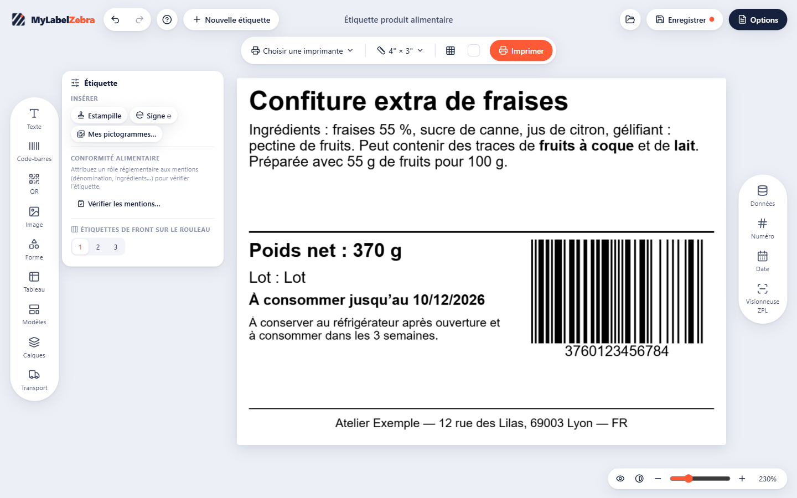

# Étiquetage alimentaire

> **Avertissement** — Les fonctions de cette page sont des **aides à la saisie et à la vérification**. Elles s’appuient sur le règlement (UE) n° 1169/2011 « INCO », la directive 2011/91/UE (lot), le règlement (CE) n° 853/2004 (estampille) et la directive 76/211/CEE (signe ℮), cités dans l’application, mais **elles ne constituent pas un conseil réglementaire** et ne garantissent pas la conformité d’une étiquette. Les exemptions, les règles nationales et les cas particuliers (allégations, origine, produits spécifiques…) ne sont pas tous couverts : faites valider vos étiquettes par un professionnel ou l’autorité compétente.

Modèles prêts à l’emploi : **Étiquette produit alimentaire 4×3** (dénomination, ingrédients avec allergènes en gras, poids net, lot à saisir, DLC, conservation, EAN-13, exploitant) et **Valeurs nutritionnelles 2×3**.

## Rôles réglementaires et vérification des mentions

Chaque élément peut recevoir un **Rôle réglementaire** (panneau de propriétés) :

| Rôle | Référence citée |
| --- | --- |
| Dénomination de la denrée | art. 9 §1 a) et art. 17 |
| Liste des ingrédients | art. 9 §1 b) et art. 18 |
| Allergènes | art. 9 §1 c) et art. 21 (peuvent figurer en gras dans la liste des ingrédients) |
| Quantité nette | art. 9 §1 e) et art. 23 |
| Date limite de consommation (DLC) | art. 9 §1 f), art. 24 et annexe X |
| Date de durabilité minimale (DDM) | art. 9 §1 f) et annexe X |
| Conditions de conservation | art. 9 §1 g) et art. 25 |
| Exploitant (nom et adresse) | art. 9 §1 h) et art. 8 |
| Pays d’origine / lieu de provenance | art. 9 §1 i) et art. 26 |
| Déclaration nutritionnelle | art. 9 §1 l) et art. 29 à 35 |
| Titre alcoométrique (TAV) | art. 9 §1 k) et art. 28 |
| Mode d’emploi | art. 9 §1 j) et art. 27 |
| Numéro de lot | directive 2011/91/UE |
| Estampille sanitaire | règl. CE 853/2004, annexe II section I |

La fenêtre **Conformité alimentaire** (panneau *Étiquette* → *Vérifier les mentions…*, menu contextuel, ou bouton de la fenêtre d’impression) liste :

- les mentions **toujours obligatoires** (dénomination, ingrédients, allergènes, quantité nette, DLC ou DDM, exploitant, déclaration nutritionnelle) absentes, avec le rappel des **exemptions courantes** ;
- les mentions **selon le produit** (conservation, origine, mode d’emploi, TAV, lot, estampille) et les cas où elles sont exigées ;
- les allergènes considérés comme couverts si la liste des ingrédients a l’option *Allergènes en gras* ;
- les mentions présentes seulement sous condition d’affichage (à vérifier sur chaque ligne) ;
- une **DLC** dont le format de date n’affiche pas le jour (l’annexe X exige au moins le jour et le mois) ;
- les textes sous la **hauteur de x** minimale ;
- le rappel du **même champ visuel** (art. 13 §5) pour la dénomination, la quantité nette et le TAV.

La fenêtre **Imprimer** affiche un avertissement (sans bloquer) si des mentions obligatoires manquent ou si une DLC n’a pas de jour.

## Hauteur de x (art. 13 §2 et annexe IV)

Option *Mention obligatoire (INCO)* d’un texte (automatique pour les rôles de l’art. 9) : l’application estime la **hauteur de x imprimée** d’après la police et la taille finale (après réduction automatique), **pour chaque ligne de données**, et la compare au seuil : **1,2 mm**, ou **0,9 mm** si la *Plus grande face de l’emballage* est inférieure à 80 cm². Le panneau indique « Conforme » ou les lignes en défaut ; la fenêtre d’impression signale les étiquettes concernées du lot.

## Allergènes en gras

Option *Allergènes en gras (INCO)* d’un texte : les 14 allergènes de l’annexe II et leurs dénominations courantes en français sont mis en gras, sans tenir compte de la casse ni des accents, en mots entiers (pluriels compris) :

céréales contenant du gluten (gluten, blé, froment, seigle, orge, avoine, épeautre, kamut, triticale, malt), crustacés (crevette, crabe, homard, langoustine…), œufs, poissons (anchois, saumon, thon, cabillaud…), arachides (cacahuète), soja, lait (lactose, lactosérum, beurre, babeurre, crème, fromage, caséine, yaourt, mozzarella, parmesan…), fruits à coque (amande, noisette, noix, cajou, pécan, pistache, macadamia, noix du Brésil, praliné…), céleri, moutarde, sésame (tahini), sulfites (anhydride sulfureux, dioxyde de soufre, métabisulfite…), lupin, mollusques (huître, calamar, poulpe, seiche, saint-jacques…).

- « Lait de coco », « beurre de cacao / de karité », « noix de coco / de muscade » ne sont pas mis en gras.
- *Allergènes supplémentaires (séparés par des virgules)* : liste propre à l’étiquette.
- Le panneau indique les allergènes repérés dans la ligne affichée ; si tout le texte est déjà en gras, il le signale.
- Le rendu est identique à l’écran, en PNG/PDF, en SVG (un `<text>` par segment) et en ZPL (texte envoyé en image).

Limite : le repérage se fait sur une liste de mots ; un mot ambigu (« noix » seul, « crème » d’un dessert sans lait…) est mis en gras par prudence. Il ne remplace pas la vérification de la liste d’ingrédients.

## DLC / DDM

Panneau **Date** → **Date limite (DLC / DDM)** :

- *DLC (« À consommer jusqu’au »)* ou *DDM (« de préférence avant le »)* ;
- *À partir de* : aujourd’hui (date d’impression) ou une colonne de données ;
- *+ jours*, *Format* (`JJ/MM/AAAA`, `JJ/MM/AA`, `JJ.MM.AAAA`, `MM/AAAA`, `JJ MMMM AAAA`), *Avec la mention* ;
- l’aperçu montre le champ et sa valeur, puis *Insérer la DLC* / *Insérer la DDM*.

Exemple inséré : `À consommer jusqu’au {{aujourdhui|jours:+21|date:JJ/MM/AAAA}}`, ou à partir d’une colonne : `{{fabrication|jours:+5|date:JJ/MM/AAAA}}`.

## Tableau nutritionnel

*Options* → *Outils* → **Valeurs nutritionnelles…** (ou *Tableau* → *Tableau nutritionnel…*) :

- saisie **pour 100 g ou 100 ml** : matières grasses, dont acides gras saturés, glucides, dont sucres, dont polyols (facultatif), fibres alimentaires (facultatif), protéines, alcool (facultatif), **sel ou sodium** (sel = sodium × 2,5) ;
- **énergie calculée** en kJ et kcal selon l’annexe XIV ;
- **arrondis** selon le guide de la Commission européenne sur les tolérances (décembre 2012) ; valeurs négligeables affichées « <0,5 g » ou « 0 g » au choix ;
- colonne facultative **par portion** ;
- contrôles de cohérence (valeur négative, saturés > matières grasses, sucres ou polyols > glucides, somme > 100 g) ;
- *Insérer* ajoute un tableau « Valeurs nutritionnelles moyennes » dimensionné pour l’étiquette, modifiable ensuite comme tout tableau. La dernière saisie est mémorisée.

## Estampille sanitaire

Panneau *Étiquette* → *Insérer* → **Estampille** (ou menu contextuel) : marque d’identification **ovale** (règl. CE 853/2004, annexe II section I) avec *Pays* (ex. FR), *Numéro d’agrément* (ex. 75.056.001, `{{champs}}` acceptés) et *Mention finale* (CE, UE ou autre texte : EC, EG, EY…), couleur, épaisseur du contour, police. Le texte est ajusté automatiquement à l’ovale. En ZPL : ovale `^GE` et texte natif, sinon image.

## Signe ℮

Panneau *Étiquette* → **Quantité estimée** (signe ℮, aussi dans le menu contextuel *Insérer*) : signe de quantité estimée (directive 76/211/CEE, annexe I point 3.3), dessiné d’après le gabarit réglementaire. Le panneau vérifie la **hauteur minimale de 3 mm** (*Mettre à 3 mm*) et rappelle qu’il doit figurer dans le même champ visuel que la quantité nominale. Imprimé en image `^GFA` dans le ZPL pour respecter exactement le dessin.

## Mes pictogrammes

Panneau *Étiquette* → **Mes pictogrammes…** : bibliothèque personnelle de fichiers **SVG, PNG ou JPG** (1,5 Mo maximum par fichier), conservée dans ce navigateur et réutilisable dans toutes les étiquettes (renommer, supprimer, ajouter à l’étiquette). Les logos officiels (Triman / Info-tri, Nutri-Score…) **ne sont pas fournis** : utilisez les fichiers remis par leurs titulaires en respectant leurs chartes d’utilisation.
